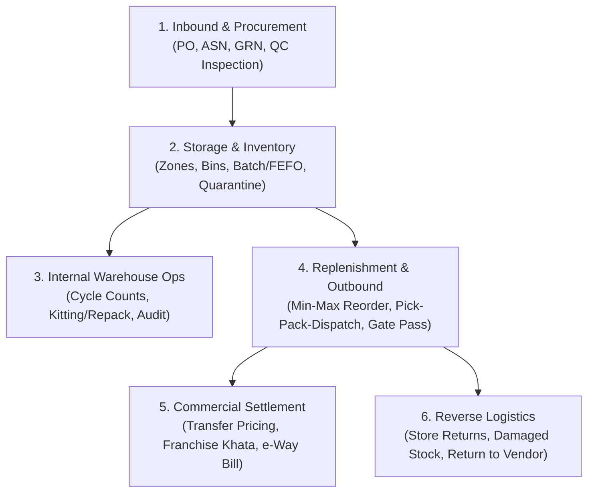
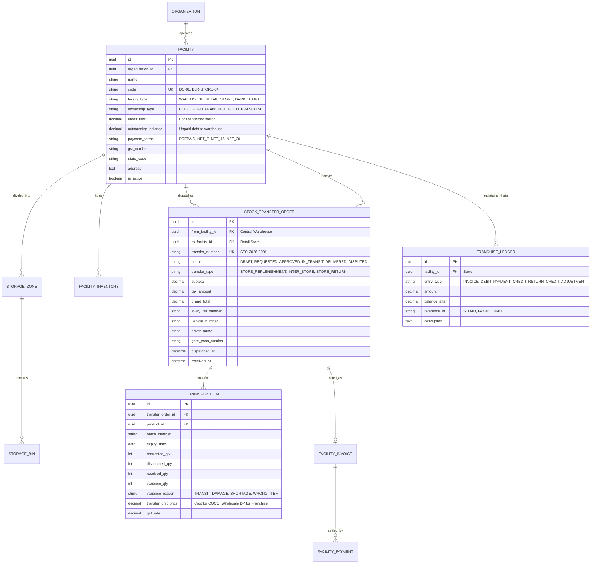

# Retail Warehouse Management System (WMS) & Multi-Echelon Supply Chain Blueprint
## Operational, Commercial, Financial & Technical Implementation Guide

| Document Attributes | Details |
|---|---|
| **Platform** | Store App — Retail ERP & Omnichannel POS |
| **System Domain** | Central Distribution Center (DC), Multi-Store Replenishment & Inter-Facility Commerce |
| **Author** | Antigravity AI Systems Architecture |
| **Status** | Complete Blueprint & Implementation Architecture |

---

## 1. Executive Vision: Beyond "Moving Boxes"

In enterprise retail, a Warehouse is not merely a physical shed with inventory; it is the **commercial, operational, and financial nexus** of the retail chain. 

A production retail supply chain must solve two simultaneous problems:
1. **The Physical Flow (Logistics & Inventory)**: Where is the stock? How was it received, batched, stored, picked, packed, dispatched, and verified without leakage or damage?
2. **The Financial Flow (Commercial Settlement & Legal Compliance)**: Who owns the stock? What is the transfer price? Is the store a company-owned branch or an independent franchise? How does money flow back from the store to the warehouse? What are the tax (GST) and e-Way bill implications?

This blueprint covers the complete spectrum required for modern multi-location retail and defines how we implement it directly into `store-app`.

---

## 2. Commercial & Financial Models: Warehouse-to-Store Settlement

The commercial relationship between the Warehouse and the receiving Store dictates the entire accounting and invoicing workflow:

```
┌────────────────────────────────────────────────────────────────────────┐
│                        CENTRAL WAREHOUSE (DC)                         │
└───────────────────────────────────┬────────────────────────────────────┘
                                    │
           ┌────────────────────────┴────────────────────────┐
           ▼                                                 ▼
┌───────────────────────────────┐         ┌───────────────────────────────┐
│     MODEL A: COCO STORE       │         │   MODEL B: FRANCHISEE (FOFO)  │
│  Company Owned, Company Run   │         │ Franchise Owned, Franchise Run│
├───────────────────────────────┤         ├───────────────────────────────┤
│ • Internal Stock Transfer     │         │ • Commercial B2B Sale         │
│ • Transfer at Cost Price      │         │ • Wholesale Billing / Margin  │
│ • No Cash Transaction         │         │ • Khata Credit Limit / Terms  │
│ • GST Rule 55 Delivery Challan│         │ • B2B Tax Invoice (with GST)  │
│ • Central Profit & Loss (P&L) │         │ • Payment Collection & AR/AP  │
└───────────────────────────────┘         └───────────────────────────────┘
```

### 2.1 Model A: Company-Owned Stores (COCO — Cost Center / Transfer Model)
- **Ownership**: The inventory continues to belong to the parent Organization before, during, and after transit.
- **Valuation / Transfer Price**:
  - *Option 1 (At Cost)*: Transferred at weighted average purchase cost (FIFO cost). No profit is recognized at the warehouse level.
  - *Option 2 (Notional Transfer Price / Cost + Markup)*: Transferred with a nominal internal markup (e.g., Cost + 5%) so the Warehouse can track its own operational efficiency as a profit center.
- **Financial Movement**: No real cash changes hands. Internal double-entry accounting adjusts `Asset: Warehouse Inventory` to `Asset: Store Inventory`.
- **Legal & GST Compliance**:
  - **Intra-State (Same State)**: Moved under **GST Rule 55 Delivery Challan** ("Supply not by way of sale").
  - **Inter-State (Different States)**: Under Indian GST, inter-state branch transfers are deemed supplies; requires a **Stock Transfer Tax Invoice** with IGST (which the receiving store claims back as Input Tax Credit - ITC).
  - **e-Way Bill**: Mandatory for any consignment value exceeding ₹50,000.

---

### 2.2 Model B: Franchise / Dealer Outlets (FOFO / FOCO — Commercial B2B Model)
- **Ownership**: When the truck leaves the warehouse dock, ownership transfers to the independent franchisee (or on receipt at their dock).
- **Commercial Relationship**: The Warehouse acts as a **B2B Wholesale Distributor** to the Franchisee Store.
- **Transfer Pricing**: The Franchisee purchases goods at **Wholesale Rate (WSR)** or **Distributor Price (DP)**, leaving a retail margin (e.g., 18–25%) between the transfer price and the customer MRP.
- **Payment & Settlement Terms**:
  1. **Prepaid / Advance**: Franchisee deposits money into their virtual wallet before warehouse dispatches goods.
  2. **Credit (Khata / Terms)**: Franchisee has an approved Credit Limit (e.g., ₹5,00,000) and commercial payment terms (`NET_7`, `NET_15`, `NET_30`).
  3. **POS Auto-Deduction (Escrow/Sweep)**: As the franchisee sells items at the POS counter, daily sales revenue is swept to settle the outstanding warehouse invoice balance.
- **Invoicing**: The Warehouse issues an official **Commercial Tax Invoice** with applicable CGST/SGST/IGST, updating Accounts Receivable (AR) for the store.

---

### 2.3 Model C: Consignment / Revenue-Share Retail
- Warehouse places inventory at the store on consignment (store pays ₹0 upfront).
- Stock belongs to the Warehouse until sold at POS counter.
- Weekly reconciliation: System tallies POS sales, computes the store's commission margin (e.g., 15%), and invoices the store for the remaining 85%.

---

## 3. The 6 Operational Domains of Retail Warehousing

A complete warehouse solution encompasses six lifecycle domains:



---

### Domain 1: Inbound & Vendor Procurement
1. **Purchase Orders (PO)**: Head office generates commercial POs to vendors specifying delivery deadlines, MOQ, and negotiated pricing (grounded in `VendorProduct`).
2. **Advance Shipping Notice (ASN) & Dock Scheduling**: Vendor notifies shipment dispatch (truck number, expected arrival, packing list). Warehouse schedules an inbound dock bay.
3. **Gate Entry & Physical Inwarding (GRN)**: Truck arrives at dock. Security/inward clerk inspects physical seals.
4. **Quality Check (QC) & Rejection**:
   - Sample verification (damaged cartons, temperature checks for perishables, seal tampering).
   - Accept good stock; reject defective items directly on dock with a **Rejection Slip / Debit Note** against the vendor.
5. **Batch, Expiry & Barcode Labeling**: If products lack manufacturer barcodes, thermal pallet/carton barcodes are printed on dock.

---

### Domain 2: Warehouse Internal Storage & Location Management
To avoid losing stock in a 50,000 sq. ft. warehouse, physical space is structured hierarchically:

```text
Warehouse (DC-01)
  └── Zone (e.g., Ambient Grocery, Cold Chain, High-Value/Electronics)
        └── Aisle (Aisle 01 to 20)
              └── Rack (Rack A to F)
                    └── Shelf (Level 1 to 5)
                          └── Bin (e.g., BIN-01-A-3-2)
```

1. **Put-away Strategies**:
   - Directed Put-away: System directs forklift/clerk to specific available bins based on item weight, velocity (Fast-moving items near dock, Slow-moving items deep in aisle), and temperature requirements.
2. **Quarantine / Damage Zone**: Segregated physical area for damaged, expired, or returned items awaiting inspection. Stock in this zone is excluded from available-to-promise (ATP) inventory.
3. **Batch & FEFO Enforcement (First Expiry, First Out)**: In FMCG and grocery, system prevents older batches from decaying behind newer arrivals. Outbound pickers are strictly routed to the earliest expiring batch.

---

### Domain 3: Internal Operations, Audits & Kitting

1. **Cycle Counting (Perpetual Inventory Audit)**:
   - Instead of shutting down the warehouse once a year for physical audit, system assigns daily cycle counts of 5–10 random bins.
   - Variances trigger an approval workflow before adjusting the ledger.
2. **Kitting, Bundling & Bulk Repackaging**:
   - **Bulk-to-Retail Repackaging**: Warehouse receives 50kg bulk sacks of grains (`CatalogueItem: Raw Wheat 50kg`) and repacks them into 1kg retail pouches with custom thermal stickers (`Product: Wheat 1kg`).
   - **Festive Gift Hampers / Combos**: Grouping multiple SKUs into a single combo pack with atomic component deduction.

---

### Domain 4: Store Replenishment & Outbound Dispatch

1. **Replenishment Triggers**:
   - **Pull Model (Store Requisition)**: Store Manager creates an internal order when shelf stock hits `low_stock_threshold`.
   - **Push Model (Allocation)**: Head office centrally allocates bulk seasonal inventory (e.g., Diwali sweets, promotional items) across 15 stores based on historical sales velocity.
   - **Auto-Replenishment (Algorithm)**: System daily calculates:
     $$\text{Replenish Quantity} = (\text{Daily Sales Velocity} \times \text{Lead Time Days}) + \text{Safety Buffer} - \text{On-Hand Stock}$$
2. **Order Picking (Pick-to-Tote / Batch Picking)**:
   - System aggregates store requisitions into wave pick-lists. Pickers walk the shortest physical path through aisles.
3. **Packing, Staging & Gate Pass**:
   - Goods packed into totes/cartons. Each carton receives a barcode label.
   - System generates **Digital Gate Pass, Packing Manifest, Delivery Challan, and e-Way Bill**.
   - Warehouse stock is atomically decremented upon gate pass security sign-off.

---

### Domain 5: Commercial Settlement & Accounts (The Missing Link)

This directly addresses the financial relationship between the warehouse and the store:

```
┌────────────────────────────────────────────────────────────────────────┐
│                   COMMERCIAL SETTLEMENT SUB-SYSTEM                     │
├────────────────────────────────────────────────────────────────────────┤
│ 1. Facility Transfer Price Matrix:                                     │
│    • Store A (COCO): Transfer Price = Cost (₹100)                     │
│    • Store B (Franchisee): Transfer Price = Wholesale DP (₹125)        │
│    • Customer MRP = ₹150                                               │
│                                                                        │
│ 2. Franchisee Billing & Ledger:                                        │
│    • Generates Internal B2B Tax Invoice on Dispatch                    │
│    • Dr. Store Accounts Receivable (AR)  ₹125,000                     │
│    • Cr. Warehouse Sales Revenue         ₹105,932                     │
│    • Cr. Output GST (18%)                ₹19,068                      │
│                                                                        │
│ 3. Credit Control & Gate:                                              │
│    • If Store Outstanding Balance + New Order > Store Credit Limit:    │
│      STOP DISPATCH -> Requires CFO / Owner override or payment deposit │
│                                                                        │
│ 4. Settlement Modes:                                                   │
│    • Bank Transfer (NEFT/RTGS/UPI)                                     │
│    • POS Daily Revenue Sweep                                           │
│    • Khata Credit Period (e.g. 15-day revolving credit)                │
└────────────────────────────────────────────────────────────────────────┘
```

---

### Domain 6: Reverse Logistics (Returns & Shrinkage)

1. **Store-to-Warehouse Return (RTV-Store)**:
   - Store sends back damaged, expired, or unsold seasonal goods.
   - Warehouse inspects at dock: accepts back into inventory, moves to quarantine, or scraps.
   - For Franchisee stores: Generates a **Credit Note (CN)**, reducing their outstanding debt.
2. **Warehouse-to-Vendor Return (RTV-Vendor)**:
   - Return of supplier-damaged or recalled stock.
   - Generates a **Debit Note (DN)** against the vendor ledger.

---

## 4. Technical Architecture: How We Implement This in `store-app`

The beauty of the current `store-app` design is that it was built with clean separation of concerns (`BaseModel`, explicit `_id` FKs, micro-apps, immutable `StockMovement` ledger). Here is the technical execution plan:

### 4.1 Database Models Expansion (`backend/db/models/`)



---

### 4.2 State Machine & Double-Entry Ledger Logic

Every transfer guarantees zero loss of inventory accounting:

```
Step 1: Store Requisition
   Store requests 50 units. No physical or financial ledger change.

Step 2: Warehouse Dispatch (TRANSFER_OUT)
   Physical:
     - Warehouse Inventory decrements by 50 units.
     - StockMovement: type = 'TRANSFER_OUT', facility = DC-01, balance_after updated.
   In-Transit:
     - 50 units tagged as IN_TRANSIT (counted in enterprise valuation).
   Financial (Franchise Store):
     - Transfer Invoice generated for 50 units @ ₹100 = ₹5,000 + GST.
     - Franchise Outstanding Balance increments by ₹5,900.

Step 3: Store Inwarding Verification (TRANSFER_IN + Variance)
   Store physically counts: 48 received, 2 broken in transit.
   Physical:
     - Store Inventory increments by 48 units.
     - StockMovement: type = 'TRANSFER_IN', facility = STORE-01, qty = +48.
     - Balancing Waste: StockMovement: type = 'DAMAGE_WASTE', facility = TRANSIT, qty = -2.
   Financial Reconciliation (Franchise Store):
     - Auto Credit Note (CN) issued for 2 damaged units (₹236 credit).
     - Franchise Outstanding Balance adjusted down from ₹5,900 to ₹5,664.
```

---

## 5. UI/UX Structure: New Frontend Modules in React + Mantine

To make this completely intuitive for store managers and warehouse operators, we introduce three core frontend views:

### 1. The Warehouse Hub (`/warehouse`)
- **Dock Reception Desk**: View scheduled vendor deliveries and 1-click launch bulk GRN inwarding with batch/expiry entry.
- **Stock Replenishment Queue**: List of pending requisitions from retail stores. Approvals, picklist generation, and batch allocation.
- **Dispatch Desk & Gate Pass Generator**: Enter vehicle/driver details, print physical packing slip, generate e-Way bill summary, and dispatch truck.

### 2. Store Replenishment Desk (`/inventory/replenish` or `/transfers`)
- **Smart Requisition Builder**: Automatically scans store items at or below low-stock threshold; 1-click *"Generate Requisition from Suggested Quantities"*.
- **Inbound Truck Receiving Checklist**: Interactive verification modal showing dispatched vs actual counted quantities, with one-click photo upload or discrepancy reporting.

### 3. Franchise Accounts & Billing (`/finance/franchise-khata`)
- **Store Credit & Ledger Summary**: Outstanding balance, credit limit bar, aging buckets (0-15 days, 16-30 days, 30+ days overdue).
- **Payment Collection Modal**: Record payments received from franchisee (Bank Transfer, Cheque, UPI, POS Cash Sweep).
- **Invoice & Credit Note Archive**: Searchable PDFs/receipts for all transfer billing.

---

## 6. Phased Implementation Roadmap

Rather than building everything in one gigantic monolithic release, we structure the rollout into progressive layers:

| Phase | Milestone | Scope Included |
|---|---|---|
| **Phase A** | **Facility & Hub Foundation** | • Add `facility_type` (`STORE` vs `WAREHOUSE`) & `ownership_type` (`COCO` vs `FRANCHISE`) to `Store`.<br>• Enable bulk GRN inwarding directly to Warehouse facilities. |
| **Phase B** | **Stock Transfer Engine & Gate Passes** | • `StockTransferOrder` & `TransferItem` models.<br>• Dispatch (`TRANSFER_OUT`) and Receive (`TRANSFER_IN`) lifecycle.<br>• Packing slips, Gate Pass generation, transit discrepancy recording. |
| **Phase C** | **Commercial Settlement & Franchise Khata** | • Transfer Pricing Matrix (Cost vs Wholesale DP).<br>• Franchise credit limits, internal B2B invoicing, and `FranchiseLedger`.<br>• Payment recording and automated Credit Notes for transit shortages. |
| **Phase D** | **Storage Bins & Advanced WMS** | • Multi-tier warehouse bin hierarchy (`Zone-Aisle-Rack-Bin`).<br>• Directed Put-away and FEFO picking routing. |

---

## 7. Summary & Recommendations

1. **Completeness**: This blueprint covers the full physical logistics (inbound, storage, picking, dispatch, transit loss) and the commercial accounting (transfer pricing, franchisee khata, credit limits, internal invoicing, GST Delivery Challans).
2. **Current Feasibility**: Because our database and micro-apps are already modularized and Phase 3 (Invoicing & POS) is coming up, building **Phase A & B** now ensures the POS engine seamlessly supports multi-location stock lookups and store replenishments from day one.
