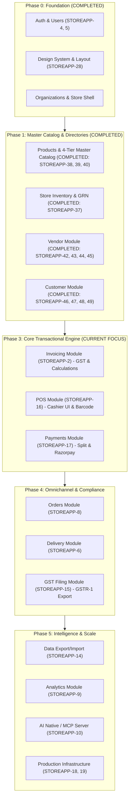

# Store App — Implementation Roadmap & Module Requirements

This document defines the strategic implementation plan, module dependency graph, completed deliverables, and initial functional requirements for all modules tracked in Plane.

---

## 🎯 Executive Summary & Sequencing Strategy

### The Golden Rule: Eliminate Developer Friction

In enterprise retail ERP & POS systems, the transactional engine (Invoicing, POS, Payments) sits downstream of **Master Data** (Products, Vendors, Customers) and **Operational Inventory**.

Building Master Catalog, Categories, and Store Inventory first eliminated mock data and established strict transactional integrity.

### 5-Phase Implementation Sequence & Current Status

---

## 📦 Delivered Modules Summary

### 1. Products & 4-Tier Master Catalog (COMPLETED — STOREAPP-38, 39, 40)

- **4-Tier Architecture**:
  1. `CatalogueItem`: Global Product Register curated at platform level with universal barcodes, HSN, and GST slabs.
  2. `Product`: Organization master product catalog.
  3. `Inventory`: Physical on-hand stock per store.
  4. `StockMovement`: Immutable transaction audit ledger.
- **Dual Barcode Architecture**: Universal manufacturer EAN-13/UPC barcode (`barcode`) and store-generated thermal sticker barcode (`internal_barcode`).
- **1-Click Global Adoption**: Retailers can browse and adopt master catalog items with pre-filled metadata.
- **Real-Time Barcode Auto-Detection**: Typing or scanning a manufacturer barcode instantly queries the Global Register with a 1-click Auto-fill helper.
- **Backend Auto-Linking Guard**: Automatically associates products with `CatalogueItem` on save.
- **Category Taxonomy**: Multi-level hierarchical categories (`Category`) and tenant-scoped subcategories (`Subcategory`).

### 2. Store Stock & Operations / Inventory (COMPLETED — STOREAPP-37)

- **Inventory View (`/inventory`)**: Live store picker, KPI cards (Total Products, Units in Stock, Low Stock, Out of Stock, Inventory Value).
- **Goods Receipt Note (GRN) Inwarding**: Multi-item stock receiving drawer with batch, cost price, store price overrides, and reference tracking.
- **Stock Adjustment Modal**: Increment/decrement stock with operational reasons (Waste/Damage, Return Restock, Audit Adjustment).
- **Stock Movement Audit Trail**: Full ledger history per store and per product.

---

### 3. Vendor Module (COMPLETED — STOREAPP-13: 42, 43, 44, 45)

- **Vendor Master & Compliance**: Tenant-scoped vendors with legal name, trade name, 15-digit GSTIN validation, auto PAN extraction, payment terms (`COD`, `PREPAID`, `NET_15`, `NET_30`, etc.), credit limits, and full address.
- **Vendor Directory UI (`/vendors`)**: Searchable directory with GST status pills, payment terms badges, bank details, and active status toggling.
- **Vendor-Product Sourcing Catalog (`VendorProduct`)**: Multi-vendor price comparison per product with vendor SKU, agreed unit cost, MOQ, lead times, and primary vendor tagging.
- **Direct GRN Integration**: Inwarding drawer integrates directly with active vendors, pre-populating purchase costs and vendor invoices on stock receiving.

### 4. Customer & Loyalty Module (COMPLETED — STOREAPP-12: 46, 47, 48, 49)

- **2-Tier Identity Architecture**:
  - `Customer`: Global tenant customer identity anchored on unique 10-digit mobile number, full name, B2C vs B2B classification, GSTIN, PAN, and birthday/anniversary milestones.
  - `StoreCustomer`: Store-specific relationship tracking store visit frequency, store loyalty points balance, credit limit (khata), and outstanding balance.
- **Customer Directory UI (`/customers`)**: Summary metrics (Total Customers, B2B Clients, Total Loyalty Points, Average Visits), customer type filters, search by phone/name/GSTIN, and CSV export.
- **Customer 360 Profile & Purchase Drawer**: Lifetime customer value strip, chronological receipt history with itemized product breakdowns, store branch loyalty cards, and compliance details.
- **POS Fast Phone Lookup (`POSCustomerLookup`)**: Sub-50ms phone lookup with automated phone formatting (`+91`, leading zeros), auto-select, and walk-in fallback.
- **Fast Counter Inline Registration (`QuickAddCustomerModal`)**: 4-field instant counter signup without cashier screen disruptions.
- **Loyalty Redemption Calculator**: Points redemption slider with smart ceiling based on store point balance and gross bill total, syncing net payable discounts to billing.

---

## 📋 Active & Upcoming Module Requirements

### 5. Invoicing Module (`STOREAPP-2` — Active Focus)

- **Plane Item**: `STOREAPP-2`
- **Ownership**: Store-level & POS checkout engine
- **Key Requirements**:
  1. **GST Compliant Calculations**: HSN-wise tax breakdown, CGST + SGST (intra-state) vs IGST (inter-state) computation based on store vs customer state codes.
  2. **Multi-Item Line Pricing**: Unit price, line discounts, tax amounts, line net totals, round-off calculation.
  3. **Invoice Types**: `POS` (Counter Sale), `ONLINE` (Ecommerce), `RETURN` (Credit Note / Return Receipt).
  4. **Invoice State Machine**: `DRAFT` ➔ `PAID` ➔ `CANCELLED`.
  5. **Atomic Stock Reduction**: Completing an invoice atomically triggers `StockMovement` reduction in store `Inventory`.

### 6. Point of Sale (POS) Module (`STOREAPP-16`)

- **Plane Item**: `STOREAPP-16`
- **Key Requirements**:
  1. High-speed cashier UI optimized for keyboard shortcuts (F1-F12, Enter, Esc).
  2. Barcode scanner listener (`barcode` and `internal_barcode`).
  3. Integration with `POSCustomerLookup` for loyalty discount calculation.
  4. Thermal receipt printing (80mm / 58mm POS receipt layout).

### 7. Payments Module (`STOREAPP-17`)

- **Plane Item**: `STOREAPP-17`
- **Key Requirements**:
  1. Split payments across multiple tenders (Cash, Card, UPI, Store Credit).
  2. Razorpay POS / Dynamic UPI QR code generation.
  3. Cash change calculator for cashiers.

---

## 🔮 Future Work & Architectural Extensions

### 8. Central Warehouse Management System (WMS) & Commercial Hub-and-Spoke Replenishment

As the retail footprint scales from isolated shops to a multi-echelon retail chain, the platform will introduce a dedicated **Central Warehouse Management & Replenishment Module**. Beyond basic physical stock movement, this architecture encompasses central bulk vendor procurement (maximizing supplier bulk discounts), 3-stage stock transfer orders (`REQUESTED` ➔ `APPROVED` ➔ `IN_TRANSIT` ➔ `RECEIVED`), in-transit shrinkage and damage reconciliation, and **commercial settlement models** tailored to store ownership:

- **Company-Owned (COCO)**: Weighted-average cost transfers governed by GST Rule 55 Delivery Challans and highway e-Way bills without cash friction.
- **Franchise Outlets (FOFO/FOCO)**: Internal B2B wholesale billing at distributor price (DP), store credit limits (khata ledger), payment collection terms (`NET_7`, `NET_15`, `NET_30`, POS sales sweep), and automated Credit Notes for transit shortages.

_For the complete end-to-end operational, financial, and schema specification, refer to the master architecture document in [`docs/future work/retail_warehouse_management_blueprint.md`](file:///Users/kartiksetia/work/new_projects/store-app/docs/future%20work/retail_warehouse_management_blueprint.md)._
