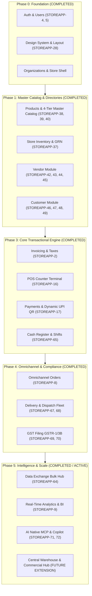

# Store App — Implementation Roadmap & Module Requirements

This document defines the strategic implementation plan, module dependency graph, completed deliverables, and functional specifications for all retail modules tracked in Plane.

---

## 🎯 Executive Summary & Sequencing Strategy

### The Golden Rule: Eliminate Developer Friction
In enterprise retail ERP & POS systems, the transactional engine (Invoicing, POS, Payments) sits downstream of **Master Data** (Products, Vendors, Customers) and **Operational Inventory**. 

Building Master Catalog, Categories, and Store Inventory first eliminated mock data and established strict transactional integrity across all operational features.

### 5-Phase Implementation Sequence & Delivery Status

---

## 📦 Implemented Module Deliverables Summary

### 1. Products & 4-Tier Master Catalog (`STOREAPP-38, 39, 40`)
- **4-Tier Architecture**: Global Product Register (`CatalogueItem`) ➔ Organization Product (`Product`) ➔ Store Inventory (`Inventory`) ➔ Stock Movement Ledger (`StockMovement`).
- **Dual Barcode Architecture**: Universal manufacturer EAN-13/UPC barcode (`barcode`) and store-generated thermal sticker barcode (`internal_barcode`).
- **1-Click Global Adoption**: Retailers can browse and adopt pre-filled master catalog items with standard HSN and GST slabs.
- **Real-Time Barcode Auto-Detection**: Scanning a manufacturer barcode in `ProductDrawer` queries the Global Register with 1-click Auto-fill and backend safety net linking.
- **Category Taxonomy**: Multi-level hierarchical categories (`Category`) and tenant-scoped subcategories (`Subcategory`).

### 2. Store Stock & Operations / Inventory (`STOREAPP-37`)
- **Inventory View (`/inventory`)**: Live store picker, KPI cards (Total Products, Units in Stock, Low Stock, Out of Stock, Inventory Value).
- **Goods Receipt Note (GRN) Inwarding**: Multi-item stock receiving drawer with batch numbers, purchase costs, store price overrides, and supplier invoice references.
- **Stock Adjustment Modal**: Increment/decrement stock with operational audit reasons (Waste/Damage, Return Restock, Audit Adjustment).
- **Stock Movement Audit Trail**: Full double-entry ledger history per store and per product.

### 3. Vendor Management & Sourcing Catalog (`STOREAPP-13: 42, 43, 44, 45`)
- **Vendor Master & Compliance**: Tenant-scoped vendors with legal name, trade name, 15-digit GSTIN validation, auto PAN extraction, payment terms (`COD`, `PREPAID`, `NET_15`, `NET_30`), credit limits, and full address.
- **Vendor Directory UI (`/vendors`)**: Searchable directory with GST status pills, payment terms badges, bank details, and active status toggling.
- **Vendor-Product Sourcing Matrix (`VendorProduct`)**: Multi-vendor price comparison per product with vendor SKU, agreed unit cost, MOQ, lead times, and primary vendor tagging.
- **Direct GRN Integration**: Inwarding drawer integrates directly with active vendors, pre-populating purchase costs and vendor invoices on stock receiving.

### 4. Customer & Loyalty Module (`STOREAPP-12: 46, 47, 48, 49`)
- **2-Tier Identity Architecture**: Global customer profile (`Customer`) anchored on unique 10-digit mobile number + store relationship (`StoreCustomer`) tracking branch visits, loyalty points, and credit limits.
- **Customer Directory UI (`/customers`)**: Summary metrics, customer type filters (Retail vs B2B), search by phone/name/GSTIN, and CSV export.
- **Customer 360 Profile Drawer**: Lifetime customer value strip, chronological receipt history with itemized product breakdowns, store branch loyalty cards, and compliance details.
- **POS Fast Phone Lookup (`POSCustomerLookup`)**: Sub-50ms phone lookup with automated phone formatting (`+91`, leading zeros), auto-select, and walk-in fallback.
- **Fast Counter Inline Registration (`QuickAddCustomerModal`)**: 4-field instant counter signup without cashier screen disruptions.
- **Loyalty Redemption Calculator**: Points redemption slider with smart ceiling based on store point balance and gross bill total.

### 5. Invoicing & Billing Engine (`STOREAPP-2, 16, 17`)
- **GST Calculations**: Line-item HSN-wise tax breakdown, CGST + SGST (intra-state) vs IGST (inter-state) computation based on store vs customer state codes.
- **Multi-Item Line Pricing**: Unit price, line discounts, tax amounts, line net totals, and round-off calculation.
- **Split Payments**: Multiple payment tenders across Cash, Card, UPI, and Store Credit.
- **Dynamic UPI QR Code**: Razorpay & UPI QR modal for instant customer counter payment.
- **Atomic Stock Depletion**: Completing an invoice atomically triggers `StockMovement` reduction in store `Inventory`.

### 6. Cash Register & Shift Z-Reports (`STOREAPP-65`)
- **Shift Management (`/register`)**: Register opening with float verification, denominations counter, and active shift locking.
- **Mid-Shift Cash Drops & Pay-Outs**: Recorded with cash drawer limits.
- **Register Closing & Z-Report Generation**: Expected vs actual cash count, over/short variance calculation, and exportable settlement slips.

### 7. Omnichannel Orders & Fulfillment (`STOREAPP-8`)
- **Omnichannel Support (`/orders`)**: Walk-in POS, phone orders, and web orders.
- **Fulfillment Pipeline**: `PENDING` ➔ `CONFIRMED` ➔ `PREPARING` ➔ `READY_FOR_PICKUP` ➔ `DISPATCHED` ➔ `COMPLETED`.
- **Order Invoicing**: Direct conversion of confirmed orders to tax invoices.

### 8. Real-Time Retail Analytics & BI (`STOREAPP-9`)
- **Executive KPI Strip (`/analytics`)**: Gross revenue, net profit margin, invoice count, and average order value (AOV).
- **Hourly Sales Velocity**: Visual heatmaps and peak hour rush detection.
- **Top Product Performance**: Velocity tracking, revenue contribution, and margin analytics.
- **Payment Method Distribution**: Tender split across Cash, UPI, Card, and Store Credit.

### 9. Data Exchange & Bulk Migration Hub (`STOREAPP-64`)
- **Multi-Entity Bulk Import (`/data-exchange`)**: CSV and Excel imports for products, inventory stock, customers, and vendors.
- **Dry-Run Validation Engine**: Complete pre-commit linting identifying schema mismatches, duplicate barcodes, or invalid GSTINs.
- **Template Download Center**: Pre-formatted standard templates with sample data.
- **Comprehensive CSV Exports**: Instant export of catalog, inventory, and customer databases.

### 10. Delivery & Fleet Dispatch Operations (`STOREAPP-67, 68`)
- **Fleet Management (`/deliveries`)**: Delivery dispatch queue with status pipeline (`PENDING`, `ASSIGNED`, `PICKED_UP`, `OUT_FOR_DELIVERY`, `DELIVERED`, `FAILED`).
- **Driver Assignment & Dispatch**: Internal driver fleet and external courier tracking.
- **Driver OTP Delivery Verification**: Secure 4-digit customer OTP verification ensuring delivery authentication.
- **Cash on Delivery (COD) Reconciliation**: Expected cash collection tracking with automated settlement.

### 11. GST Filing & Statutory Tax Compliance (`STOREAPP-69, 70`)
- **GSTR-1 Tax Engine (`/gst`)**: Outward supplies breakdown across B2B, B2CL (large consumer), B2CS (small consumer), CDNR/CDNUR credit notes, and HSN summary.
- **GSTR-3B Tax Liability Table**: Statutory Table 3.1 outward taxable supplies and Table 3.2 inter-state supplies summary.
- **Statutory GSTN JSON Exporter**: Direct one-click export of government GSTN offline tool-compliant JSON files.
- **Filing Periods Ledger**: Monthly and quarterly period tracking (`DRAFT`, `READY`, `FILED`) with ARN recording and audit lock.

### 12. AI-Native Model Context Protocol (MCP) & Retail Copilot (`STOREAPP-71, 72`)
- **Store App MCP Server (`backend/apps/mcp/`)**: Standard JSON-RPC 2.0 endpoint (`POST /api/mcp/rpc/`) and REST discovery (`GET /api/mcp/tools/`).
- **7 Live Retail MCP Tools**:
  1. `search_products`: Multi-attribute catalog lookup.
  2. `check_inventory`: Stock levels, low-stock alerts, and valuation.
  3. `get_daily_sales_summary`: Real-time gross turnover, net revenue, GST split, and tender distribution.
  4. `lookup_customer`: Customer 360, multi-store loyalty balance, and visit counts.
  5. `get_gst_filing_summary`: Monthly/quarterly GSTR-1 and GSTR-3B tax liability.
  6. `list_stores`: Active physical store directory.
  7. `lookup_order`: Order tracking and customer details.
- **Dual AI Copilot Engine**:
  - **Online Mode**: Multi-turn autonomous tool execution loop supporting OpenRouter and OpenAI APIs.
  - **Zero-Key Offline Fallback**: Direct intent routing against Django ORM models when external API keys are omitted.
- **Frontend Retail Copilot Drawer**: Global top navbar sparkles button, quick prompt chips, tool execution transparency disclosure, and rich Markdown tables.
- **AI Settings Hub (`/ai-settings`)**: Provider selection, model picker, client-side masked API key storage, and connection test pings.

---

## 🔮 Future Work & Architectural Extensions

### Central Warehouse Management System (WMS) & Commercial Hub-and-Spoke Replenishment

As the retail footprint scales from isolated shops to a multi-echelon retail chain, the platform will introduce a dedicated **Central Warehouse Management & Replenishment Module**. Beyond basic physical stock movement, this architecture encompasses central bulk vendor procurement (maximizing supplier bulk discounts), 3-stage stock transfer orders (`REQUESTED` ➔ `APPROVED` ➔ `IN_TRANSIT` ➔ `RECEIVED`), in-transit shrinkage and damage reconciliation, and **commercial settlement models** tailored to store ownership:

- **Company-Owned (COCO)**: Weighted-average cost transfers governed by GST Rule 55 Delivery Challans and highway e-Way bills without cash friction.
- **Franchise Outlets (FOFO/FOCO)**: Internal B2B wholesale billing at distributor price (DP), store credit limits (khata ledger), payment collection terms (`NET_7`, `NET_15`, `NET_30`, POS sales sweep), and automated Credit Notes for transit shortages.

_For the complete end-to-end operational, financial, and schema specification, refer to the master architecture document in [`docs/future work/retail_warehouse_management_blueprint.md`](file:///Users/kartiksetia/work/new_projects/store-app/docs/future%20work/retail_warehouse_management_blueprint.md)._
