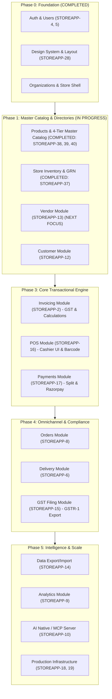

# Store App — Implementation Roadmap & Module Requirements

This document defines the strategic implementation plan, module dependency graph, completed deliverables, and initial functional requirements for all modules tracked in Plane.

---

## 🎯 Executive Summary & Sequencing Strategy

### The Golden Rule: Eliminate Developer Friction
In enterprise retail ERP & POS systems, the transactional engine (Invoicing, POS, Payments) sits downstream of **Master Data** (Products, Vendors, Customers) and **Operational Inventory**. 

Building Master Catalog, Categories, and Store Inventory first eliminated mock data and established strict transactional integrity.

### 5-Phase Implementation Sequence & Current Status

---

## 📦 Delivered Modules Summary

### 1. Products & 4-Tier Master Catalog (COMPLETED — STOREAPP-38, 39, 40)
- **4-Tier Architecture**:
  1. `CatalogueItem`: Global Product Register curated at platform level with universal barcodes, HSN, and GST slabs.
  2. `Product`: Organization master product catalog.
  3. `Inventory`: Physical on-hand stock per store.
  4. `StockMovement`: Immutable transaction audit ledger.
- **Dual Barcode Architecture**: Universal manufacturer EAN-13/UPC barcode (`barcode`) and store-generated thermal sticker barcode (`internal_barcode`).
- **1-Click Global Adoption**: Retailers can browse and adopt master catalog items with pre-filled metadata.
- **Real-Time Barcode Auto-Detection**: Typing or scanning a manufacturer barcode instantly queries the Global Register with a 1-click Auto-fill helper.
- **Backend Auto-Linking Guard**: Automatically associates products with `CatalogueItem` on save.
- **Category Taxonomy**: Multi-level hierarchical categories (`Category`) and tenant-scoped subcategories (`Subcategory`).

### 2. Store Stock & Operations / Inventory (COMPLETED — STOREAPP-37)
- **Inventory View (`/inventory`)**: Live store picker, KPI cards (Total Products, Units in Stock, Low Stock, Out of Stock, Inventory Value).
- **Goods Receipt Note (GRN) Inwarding**: Multi-item stock receiving drawer with batch, cost price, store price overrides, and reference tracking.
- **Stock Adjustment Modal**: Increment/decrement stock with operational reasons (Waste/Damage, Return Restock, Audit Adjustment).
- **Stock Movement Audit Trail**: Full ledger history per store and per product.

---

## 📋 Active & Upcoming Module Requirements

### 3. Vendor Module (`STOREAPP-13` — Current Focus)
* **Plane Item**: `STOREAPP-13`
* **Ownership**: Organization-level (Suppliers & Distributors)
* **Requirements**:
  1. **Vendor Profile**: Legal Business Name, Trade Name, GSTIN (15-char with regex validation), PAN (auto-extracted), Contact Person Name, Email, Primary Phone Number, Billing/Shipping Address with 2-digit GST State Code.
  2. **Payment Terms**: Commercial credit terms (`COD`, `PREPAID`, `NET_7`, `NET_15`, `NET_30`, `NET_45`, `NET_60`) and credit limit.
  3. **Vendor Product Catalog (`VendorProduct`)**: Links which products a vendor supplies, vendor SKU, negotiated purchase price, lead time, and MOQ.
  4. **Inwarding Integration**: Link vendor directly to Goods Receipt Notes (GRN) during stock inwarding in `/inventory`.
  5. **APIs**:
     - `GET /api/vendors/` (filter by active status, search by name/GSTIN/phone)
     - `POST /api/vendors/` (create vendor profile with GSTIN validation)
     - `GET/PUT/DELETE /api/vendors/<id>/`
     - `GET /api/vendors/<id>/products/` (list supplied products & pricing)
  6. **Frontend UI**:
     - Vendor directory with GST status pills, payment terms badges, and quick contact links.
     - Sectioned Vendor Drawer (General Info, GST & Compliance, Contact & Address, Bank Details & Credit Terms).

---

### 4. Customer Module (`STOREAPP-12` — Next Up)
* **Plane Item**: `STOREAPP-12`
* **Ownership**: 2-Tier Architecture (Global `Customer` + Store `StoreCustomer`)
* **Requirements**:
  1. **Global Customer Identity**: Phone Number (unique anchor, 10-digit normalized), Full Name, Email.
  2. **Store Customer Association (`StoreCustomer`)**: Store FK, Customer FK, Total Spend, Visit Count, Loyalty Points Balance, Store Credit / Khata Balance, First Visit & Last Visit Timestamps.
  3. **High-Speed Phone Lookup**: POS-optimized lookup endpoint returning customer info + store loyalty summary in < 50ms.
  4. **Auto-Enrollment**: If phone number scanned/typed at checkout does not exist, system auto-creates a guest profile without blocking cashier flow.
  5. **APIs**:
     - `GET /api/customers/` (search by phone or name)
     - `GET /api/customers/lookup/?phone=9876543210` (fast POS lookup)
     - `POST /api/customers/` (create/register customer)
     - `GET /api/customers/<id>/history/` (view past invoices and credits)
  6. **Frontend UI**:
     - Customer directory with spend, visit counts, and loyalty points.
     - Customer Detail Drawer with transaction history.
