# Store App — Implementation Roadmap & Module Requirements

This document defines the strategic implementation plan, module dependency graph, and initial functional requirements for all modules tracked in Plane.

---

## 🎯 Executive Summary & Sequencing Strategy

### The Golden Rule: Eliminate Developer Friction
In enterprise retail ERP & POS systems, the transactional engine (Invoicing, POS, Payments) sits downstream of **Master Data** (Products, Vendors, Customers) and **Operational Inventory**. 

Attempting to build Invoicing (`STOREAPP-2`) or POS (`STOREAPP-16`) first creates massive friction because developers are forced to write mock products, hardcoded stock levels, and stubbed customer records—only to throw them away and refactor later.

### Recommended 5-Phase Implementation Sequence

```mermaid
flowchart TD
    subgraph P0 ["Phase 0: Foundation (Completed)"]
        AUTH["Auth & Users (STOREAPP-4, 5)"]
        UI["Design System & Layout (STOREAPP-28)"]
        BASE["Organizations & Store Shell"]
    end

    subgraph P1 ["Phase 1: Master Catalog & Directory (Next Focus)"]
        PROD["Products & Master Catalog"]
        VEND["Vendor Module (STOREAPP-13)"]
        CUST["Customer Module (STOREAPP-12)"]
    end

    subgraph P2 ["Phase 2: Store Stock & Operations"]
        STORE_EXT["Stores Module (STOREAPP-7) - Settings & Staff"]
        INV["Inventory Module (STOREAPP-11) - Store Stock & Batches"]
    end

    subgraph P3 ["Phase 3: Core Transactional Engine"]
        INVOICE["Invoicing Module (STOREAPP-2) - GST & Calculations"]
        POS["POS Module (STOREAPP-16) - Cashier UI & Barcode"]
        PAY["Payments Module (STOREAPP-17) - Split & Razorpay"]
    end

    subgraph P4 ["Phase 4: Omnichannel & Compliance"]
        ORDERS["Orders Module (STOREAPP-8)"]
        DELIVERY["Delivery Module (STOREAPP-6)"]
        GST["GST Filing Module (STOREAPP-15) - GSTR-1 Export"]
    end

    subgraph P5 ["Phase 5: Intelligence & Automation"]
        ETL["Data Export/Import (STOREAPP-14)"]
        ANALYTICS["Analytics Module (STOREAPP-9)"]
        MCP["AI Native / MCP Server (STOREAPP-10)"]
        DEPLOY["Production Infrastructure (STOREAPP-18, 19)"]
    end

    P0 --> P1
    P1 --> P2
    P2 --> P3
    P3 --> P4
    P4 --> P5
```

---

## 📋 Phase 1: Master Data & Catalog (Immediate Priority)

Targeting these three modules first provides the foundational records that all subsequent transactions link to.

### 1. Products & Master Catalog Module
* **Plane Item**: Pre-requisite for `STOREAPP-11` & `STOREAPP-2`
* **Ownership**: Organization-level (Centralized Catalog)
* **Initial Requirements**:
  1. **Category & Brand Hierarchy**: Tree structure (`Grocery > Dairy > Milk`), Brand entity.
  2. **Product Master Data**: Name, SKU, EAN-13/UPC Barcode, Description, HSN Code (mandatory for GST), Base MRP, Cost Price, Tax/GST slab (0%, 5%, 12%, 18%, 28%), Unit of Measure (`pcs`, `kg`, `litre`, `box`).
  3. **Product Attributes & Flags**: Is Perishable, Has Expiry Date, Returnable (yes/no), Minimum stock warning threshold.
  4. **APIs**:
     - `GET /api/products/` (paginated, searchable by name/SKU/barcode, filterable by category/brand)
     - `POST /api/products/` (create master product)
     - `GET/PUT/DELETE /api/products/<id>/`
     - `GET /api/products/barcode/<code_or_sku>/` (high-speed exact lookup)
  5. **Frontend UI**:
     - Master Product Table with Category badge, MRP, HSN code, and Barcode.
     - Product Creation & Edit Drawer/Modal.
     - Live Barcode generation / preview.

---

### 2. Vendor Module (`STOREAPP-13`)
* **Plane Item**: `STOREAPP-13`
* **Ownership**: Organization-level (Suppliers)
* **Initial Requirements**:
  1. **Vendor Profile**: Legal Business Name, Trade Name, GSTIN, PAN, Contact Person Name, Email, Primary Phone Number, Billing/Shipping Address.
  2. **Payment Terms**: Payment credit terms (Net 15, Net 30, COD, Advance).
  3. **Vendor Product Catalog**: Linking which master products are supplied by which vendor, with default purchase/cost price.
  4. **Vendor Status**: `Active`, `Suspended`, `Inactive`.
  5. **APIs**:
     - `GET /api/vendors/` (filter by active status, search by name/GSTIN/phone)
     - `POST /api/vendors/` (create vendor profile with GSTIN validation)
     - `GET/PUT/DELETE /api/vendors/<id>/`
     - `GET /api/vendors/<id>/products/` (list supplied products)
  6. **Frontend UI**:
     - Vendor directory with GST status pills and quick phone contact links.
     - Vendor profile view showing contact information and supplier items.

---

### 3. Customer Module (`STOREAPP-12`)
* **Plane Item**: `STOREAPP-12`
* **Ownership**: 2-Tier Architecture (Global `Customer` + `StoreCustomer`)
* **Initial Requirements**:
  1. **Global Customer Identity**: Phone Number (unique anchor, 10-digit normalized), Full Name, Email, Optional link to `auth.User` for future web accounts.
  2. **Store Customer Association (`StoreCustomer`)**: Store FK, Customer FK, Total Spend, Visit Count, Loyalty Points Balance, Store Credit / Khata Balance, First Visit & Last Visit Timestamps.
  3. **High-Speed Phone Lookup**: POS-optimized lookup endpoint returning customer info + store loyalty summary in < 50ms.
  4. **Auto-Enrollment**: If phone number scanned/typed at checkout does not exist, system auto-creates a guest customer profile without blocking the cashier.
  5. **APIs**:
     - `GET /api/customers/` (search by phone or name)
     - `GET /api/customers/lookup/?phone=9876543210` (fast POS lookup)
     - `POST /api/customers/` (create/register customer)
     - `GET /api/customers/<id>/history/` (view past invoices and credits)
  6. **Frontend UI**:
     - Customer directory with spend, visit counts, and loyalty points.
     - Customer Detail Drawer with transaction history.

---

## 🏬 Phase 2: Store Operations & Inventory Control

### 4. Stores Module Expansion (`STOREAPP-7`)
* **Plane Item**: `STOREAPP-7`
* **Initial Requirements**:
  1. **Store Details**: Store Name, Store Code, Store GSTIN, Address, Phone, Operating Hours.
  2. **Store Staff & Role-Based Access Control**:
     - Link `auth.User` to `Store` with roles: `STORE_ADMIN`, `STORE_MANAGER`, `CASHIER`, `INVENTORY_CLERK`.
     - Only users with active `StoreStaff` can log in to a specific store context.
  3. **Store Config & Printing Preferences**:
     - Invoice prefix (e.g., `INV-DL1-2026-`), receipt header/footer notes, tax calculation mode (GST inclusive vs exclusive).
  4. **Active Store Context**:
     - Session/JWT reflects the active store. Switching store re-scopes all inventory and billing queries.

---

### 5. Inventory Module (`STOREAPP-11`)
* **Plane Item**: `STOREAPP-11`
* **Initial Requirements**:
  1. **Store Stock Ledger**: Maps `Store` + `Product` + `Vendor`.
  2. **Stock Parameters**: `quantity_on_hand`, `reorder_threshold`, `store_selling_price` (allows store-specific pricing overrides), `batch_number`, `expiry_date`.
  3. **Stock Movement Ledger**: Immutable audit log capturing all stock shifts:
     - `PURCHASE_RECEIPT` (Stock in via Goods Received Note / GRN)
     - `POS_SALE` (Stock out on invoice generation)
     - `RETURN_RESTOCK` (Stock in on customer return)
     - `DAMAGE_WASTE` (Stock out for expired/damaged items)
     - `MANUAL_CORRECTION` (Audit reconciliation)
  4. **Stock Receipt (GRN - Goods Received Note)**:
     - Flow for staff to receive vendor shipments, verify quantities against PO/Invoice, record batch/expiry, and increase store stock.
  5. **Alerts**: Real-time notifications for items at or below `reorder_threshold`.

---

## ⚡ Phase 3: Core Transactional Engine (Invoicing, POS & Payments)

### 6. Invoicing Module (`STOREAPP-2`)
* **Plane Item**: `STOREAPP-2`
* **Initial Requirements**:
  1. **Invoice Numbering**: Sequential, compliant numbering (e.g. `STORE-YYYY-MM-XXXXX`).
  2. **Pricing & Discount Engine**:
     - Item-level discounts (percentage or flat).
     - Bill-level cart discount (coupon or cashier discretion).
     - Minimum selling price constraint (cannot sell below cost without manager override).
  3. **Automated GST Engine**:
     - Automatic detection of Intra-state (CGST + SGST split 50/50) vs Inter-state (IGST 100%) based on Store state vs Customer shipping state.
     - HSN-wise tax breakdown on invoice footer.
  4. **Immutable Line-Item Snapshot**:
     - `InvoiceItem` records exact product name, SKU, HSN, tax rate, and unit price at moment of sale.
  5. **Returns & Credit Notes**:
     - Partial or full return against past invoice; automatically decrements customer spend, generates Credit Note, and returns items to inventory.
  6. **PDF & Thermal Receipt Generation**:
     - Printable 80mm / 58mm thermal format for POS ESC/POS printers.
     - A4/A5 PDF invoice format for B2B transactions.

---

### 7. POS Module (`STOREAPP-16`)
* **Plane Item**: `STOREAPP-16`
* **Initial Requirements**:
  1. **Cashier Speed Terminal**: Ergonomic full-screen UI optimized for keyboard-only and barcode scanner operation.
  2. **Multi-Tab Cart Billing**:
     - Cashier can hold customer 1's cart in a suspended tab, bill customer 2, and resume customer 1 with one click/hotkey.
  3. **Hardware Barcode Scanner Support**: Instant item lookup upon barcode scanning.
  4. **Cashier Hotkeys**:
     - `F1`: Focus customer phone lookup.
     - `F2`: Add item discount.
     - `F4`: Open tender & payment modal.
     - `Enter`: Finalize, print receipt & open cash drawer.
     - `Esc`: Clear or suspend cart.

---

### 8. Payments Module (`STOREAPP-17`)
* **Plane Item**: `STOREAPP-17`
* **Initial Requirements**:
  1. **Multi-Tender Split Payments**: Support paying an invoice with multiple payment modes (e.g., ₹500 Cash + ₹1200 UPI).
  2. **Tender Types**: `CASH` (with change due calculation), `CARD` (terminal reference ID), `UPI_QR` (dynamic QR generation), `STORE_CREDIT` / `LOYALTY_POINTS`.
  3. **Razorpay Integration**:
     - Dynamic UPI QR generation displayed on cashier / customer screen.
     - Webhook receiver verifying cryptographic signature and auto-marking payment as complete.
  4. **Cash Drawer Reconciliation**: Day-end cash drawer opening float vs closing cash tally.

---

## 🚚 Phase 4: Omnichannel Fulfillment & Compliance

### 9. Orders & Delivery Module (`STOREAPP-8`, `STOREAPP-6`)
* **Plane Items**: `STOREAPP-8`, `STOREAPP-6`
* **Initial Requirements**:
  1. **Omnichannel Order Handling**: In-store takeaway, telephone delivery orders, and online pickup.
  2. **Order Lifecycle**: `PLACED` ➔ `CONFIRMED` ➔ `PACKED` ➔ `OUT_FOR_DELIVERY` ➔ `DELIVERED`.
  3. **Delivery Management**: Assign delivery rider/partner, capture customer delivery address, track delivery status and delivery confirmation OTP.

---

### 10. GST Filing Module (`STOREAPP-15`)
* **Plane Item**: `STOREAPP-15`
* **Initial Requirements**:
  1. **B2B vs B2C Segmentation**: Distinguish registered commercial buyers (with GSTIN) from retail consumers.
  2. **GSTR-1 JSON/CSV Export**:
     - B2B Invoices (Table 4)
     - B2CL (Interstate large) (Table 5)
     - B2CS (Intrastate retail) (Table 7)
     - HSN-wise outward supply summary (Table 12)
     - Document Issued tally (Table 13)
  3. **Tax Summary Dashboard**: Real-time tax liability metrics (CGST, SGST, IGST collected).

---

## 🧠 Phase 5: Intelligence, Analytics & Automation

### 11. Data Export <> Import Module (`STOREAPP-14`)
* **Initial Requirements**: Bulk CSV/Excel upload of master products, bulk stock adjustment spreadsheets, customer data import/export.

### 12. Analytics Module (`STOREAPP-9`)
* **Initial Requirements**: Daily/weekly revenue trends, gross margin per category, top 20 revenue drivers, slow-moving/dead inventory alerts.

### 13. AI Native – MCP Module (`STOREAPP-10`)
* **Initial Requirements**:
  - Model Context Protocol (MCP) server exposing tools: `search_inventory`, `check_stock_availability`, `get_daily_sales`, `lookup_customer`.
  - Natural language POS Copilot ("Do we have 1L toned milk in North Store?").

### 14. Architecture Scale & Deploy (`STOREAPP-18`, `STOREAPP-19`)
* **Initial Requirements**: Celery + Redis worker for async PDF/CSV processing; WebSocket support for multi-counter live cart/register sync; production container deployment.

---

## 🚀 Immediate Next Action: Phase 1 Kickoff

To begin execution with zero friction:
1. **Target**: **Master Catalog & Products** (`Phase 1, Item 1`)
2. **Tasks to break down in Plane**:
   - `STOREAPP-29`: Implement Category, Brand & Master Product models + migrations in `backend/db/`
   - `STOREAPP-30`: Implement Product REST API serializers, filters & views in `backend/apps/products/`
   - `STOREAPP-31`: Implement React Product Master Table & Creation Drawer with StoreCraft Design System
